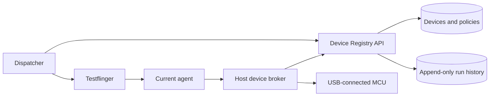

# Failure demonstrations and USB device identity

Prepared for the 2026-10-31 demo. The scenarios below are offline unless
explicitly marked as a supervised live drill. Nothing in the scenario runner
submits a Testflinger job, connects to AWS, opens a real serial port, or flashes
an MCU. No database or automatic device migration has been deployed.

## Run the prepared scenarios

From the repository root, using the existing laptop test environment:

```sh
PYTHON=/home/be-mihai22/code/tf-venv/.venv/bin/python
"$PYTHON" scripts/demo-scenarios.py --list
"$PYTHON" scripts/demo-scenarios.py all
"$PYTHON" scripts/demo-scenarios.py usb-missing usb-wrong-device usb-disconnect
```

On another machine, use a Python environment with this repository's `.[test]`
dependencies and pyserial installed. The native baseline also needs `cc`,
Bubblewrap, and util-linux `prlimit` on Linux. No dependency installation occurs
during a scenario. Missing optional prerequisites produce an incomplete result
and a nonzero runner exit, not a claimed success.

Each invocation creates a fresh `artifacts/demo-<timestamp>-<suffix>/` with
per-scenario console logs, JUnit XML, and `summary.json`. A custom `--output`
must name a directory that does not exist. Tests use disposable fixtures;
reports are retained. External pytest plugin autoload is disabled.

**A passing negative test means the injected failure was caught correctly.**
These are real validator/adapter tests with mocked infrastructure, not red
GitHub workflow runs or physical USB experiments. The baseline compiles and
runs the shared C test locally but mocks Testflinger traffic.

| Scenario | Injected condition | Expected protection / evidence |
| --- | --- | --- |
| `baseline` | None; compile and sandbox the native binary | Five checks, matching identity and attachment bytes |
| `build-failure` | Mock Workshop command failure; absent bundle | No bundle on build failure; missing bundle causes no API calls |
| `integrity` | Change binary bytes; present a wrong-chip image | Hash or chip validation rejects before deployment |
| `routing` | Unexpected queue owner; wrong device queue | Submission or agent preflight rejects |
| `usb-missing` | Configured port does not exist | No flasher or serial calls |
| `usb-wrong-device` | Mock chip probe returns another MAC | One identity probe, zero flash writes |
| `usb-disconnect` | Mock flasher fails during its write | One write attempt, failure log, no retry or pass proof |
| `partition-policy` | Unapproved partition-table digest | No Testflinger POST |
| `host-disabled` | Administrator-controlled device disabled | Agent preflight rejects |
| `stale-proof` | Old nonce, wrong build identity, failed output | Returned evidence cannot pass |
| `runtime-failure` | Mock nonzero process exit or timeout | No passing laptop proof file |
| `submission-uncertain` | POST times out with acceptance unknown | Durable intent blocks a second POST for that run ID |
| `evidence` | Failed phase or mismatched proof despite completion | Completion alone cannot produce a pass |

## Ten-minute presentation

1. Show [successful run 41026852865](https://github.com/bem22/HILAAS-Demo/actions/runs/41026852865).
   Follow its source commit through Workshop, manifest digest, Testflinger job,
   and laptop output. Show artifact `native-41026852865-1` and its five checks.
2. Run `build-failure integrity`. Explain why no device job should exist when
   the build or artifact is rejected. Point to the no-POST assertions.
3. Run `usb-wrong-device usb-disconnect`. Explain the difference between
   refusing the wrong chip before a write and an uncertain partial flash.
4. Run `runtime-failure stale-proof evidence`. Show that a job being complete
   is not sufficient: phase exit codes, identity, nonce, and proof must agree.
5. Run `submission-uncertain`. Explain why retrying a network request could
   flash twice, and why an existing receipt must be investigated first.
6. End with the identity diagram below: the MCU retains its history when moved;
   the agent is only its current execution location. Label this as the proposed
   registry architecture, not functionality already demonstrated.

For live pipeline failures, use a reviewed, allowlisted fault input in a
dedicated manual demo workflow as a future addition. There is no such input
today. Do not edit the persistent runner checkout mid-job or disable validators.
A deliberate compiler error or wrong CRC expected value will fail Workshop
compilation/CTest before submission; it will not demonstrate a laptop runtime
failure. A runtime-only fault needs an agent-side injection or controlled test
binary that passes the build gate, with its source and fault mode disclosed.

## Find the failing boundary

Use the tuple `source commit, run ID, job UUID, device ID, artifact digest,
nonce` to correlate evidence. Device UUID is proposed below; today's MCU path
uses the configured C6 MAC, and the native path has no physical MCU identity.

| Boundary | Where to look | Interpretation / recovery |
| --- | --- | --- |
| GitHub dispatch / runner | Workflow job and step states | Queued can mean runner unavailable; skipped can mean branch/event guards. Do not enable PR execution on this privileged runner. |
| Spread / Workshop | Build launch, build, and stop logs under `artifacts/<run-id>/build/` | Build or cleanup failure can stop allocation before any TF job. Inspect the run-specific Workshop before reusing resources. |
| Worker allocation | Spread output, run-specific worker lease | Missing image, ownership, marker, or network failure is infrastructure failure, not a board failure. Never delete unrelated instances. |
| Authentication / preflight | Client error and queue/agent status | Authentication and early preflight can fail before a receipt exists. A cached `waiting` state alone does not prove a fresh heartbeat. |
| Submission / attachments | Receipt stage and durable ledger | A UUID in an intent ledger does not prove server acceptance. Inspect that UUID; do not repost after a timeout. |
| USB / flash / serial | Agent test output, JUnit, flash and serial logs | Distinguish probe failure, wrong chip, failed write, verify failure, and missing fresh nonce. Failed jobs may have incomplete artifacts. |
| Evidence validation | Phase results plus returned archive | Require expected phase statuses and correlated proof, not merely `job_state=complete`. |
| Artifact upload | Separate GitHub upload step | A device test can pass while publication fails. The previous colon-containing path failure is an example. |
| Browser | Public HTTPS versus private API | Browser failure does not imply server or agent failure. Recently stale CNI rules broke ingress while private jobs still worked. |

Do not deliberately break shared LXD, MongoDB, ingress, security groups, or
credentials for a live demonstration. Use mocked failures or a separate disposable
environment. Never show token files, database credentials, or full secret-bearing
service configurations on screen.

## USB drills with real boards

Only perform these after that exact board has a verified build and a successful
authorized flash. Quiesce its queue, confirm no job/lease is active, and use an
approved spare board. The table is a procedure, not implemented automation.

| Drill | Controlled action | Expected observation | Recovery |
| --- | --- | --- | --- |
| Cable missing before test | Disconnect the idle board's data cable before starting the approved job | Port lookup fails before identity probe or flash | Reconnect, rediscover, verify identity, inspect the failed job, then use a new job |
| Different board on same cable | While idle, connect another approved same-family board without changing expected chip identity | Read chip identity; reject mismatch before `write_flash` | Restore the intended board and verify identity again |
| USB renumbering | Reconnect an idle board on another port/hub | `/dev/ttyUSB0` may change; a genuine unique by-id alias should follow the interface | Rediscover; never substitute another tty solely because its number matches |
| Bootloader re-enumeration | Use the board's documented mode transition while idle | PID, interface, and device path may change | A board adapter must recognize the transition and reverify the target; this is not implemented generically |
| Move agent A to B | Drain A, release ownership, disconnect, then attach to B | Today: manual approved configuration; proposed registry: same device UUID, new binding generation | Verify chip identity on B and retire A's route before submitting |
| USB disconnect during write | Use the offline `usb-disconnect` scenario for the presentation | Real disconnect could leave partially programmed flash | Never unplug deliberately during a real write; inspect and recover through the board's documented bootloader procedure |

An identity probe can reset or attach to a board even when it does not write
flash. Do not call it non-disruptive during an active test. A successful flash
followed by failed runtime checks does not automatically restore prior firmware.

Safe discovery commands on the selected agent host, while the board is idle:

```sh
ls -l /dev/serial/by-id/
udevadm info --query=property --name=/dev/ttyACM0
udevadm monitor --udev --property --subsystem-match=tty
```

The tty name above is an example for inspection, not a persistent configuration.
Stop the monitor with Ctrl-C. Monitor the USB subsystem too for debugger or DFU
interfaces that do not create tty devices. Inside an agent container, also check
USB passthrough and permissions; host discovery does not prove container access.

## MCU identity independent of agent

Assign an internal immutable `device_id` UUID and label the physical unit with
an asset tag/QR code. Bind it during trusted enrollment to a verified chip
identifier. Do not use the queue, agent name, hostname, USB port, or tty path as
the device's primary key.

| Identifier | Meaning | Use |
| --- | --- | --- |
| Registry UUID | The enrolled physical test asset | Primary key for history, policies, and ownership |
| Factory chip identity | The MCU actually being programmed | Required identity check before destructive actions |
| USB bridge serial | CP210x/FTDI/other interface | Discovery hint; not necessarily the MCU identity |
| Debug probe serial | ST-LINK/J-Link/DAPLink interface | Locate the probe; it can sometimes be connected to another target |
| VID/PID and USB topology | Interface model, mode, current location | Discovery and diagnostics, never uniqueness alone |
| Agent ID and local path | Current execution attachment | Short-lived binding with timestamps and generation |

For ESP32-C6, enroll the factory/eFuse-derived base MAC read by the reviewed
chip adapter, not the agent's Wi-Fi MAC or a firmware-configurable network MAC.
For micro:bit V1/V2, use the appropriate Nordic target's FICR device identity;
verify the chip family, read method, and accessibility separately for each
revision. For STM32 Nucleo, use that target MCU's factory UID where supported,
not the ST-LINK serial. Register offsets and read procedures are family-specific.
No Nordic/STM32 identity adapter has been implemented or verified here.

Store identities as normalized, namespaced values, for example
`espressif/esp32c6/factory-base-mac`. Record how the identity was read and its
verification status. Duplicate/blank USB serials, inaccessible chip IDs, and
conflicting observations must cause quarantine or manual enrollment, not an
automatic merge. A replacement MCU gets a new identity record linked to the
retired asset; do not silently overwrite the old chip identifier.

A UID identifies a chip but does not cryptographically attest its firmware.
For adversarial agents/devices, add hardware-backed challenge-response and an
explicit trust model. A firmware-reported string or a matching hash is not that.

## Proposed device registry

Use a small central registry API, not direct database access from every agent.
Keep its storage separate from Testflinger's internal job collections. Reusing
the existing MongoDB deployment with a dedicated database and least-privilege
service account avoids another database server, but needs separate approval,
backup/restore checks, and resource review. No database changes are made here.
PostgreSQL is also suitable if relational constraints and transactions are
preferred; the device/attachment/lease separation remains the same.



Suggested logical records:

| Record | Essential fields |
| --- | --- |
| Device | UUID, asset tag, exact board/revision, MCU family, verified namespaced identity, lifecycle state, approved flash policy/version |
| Attachment | Device UUID, agent ID, host/broker ID, transport, USB/probe serial, current by-id path, mode, generation, last-seen and expiry |
| Lease | Device UUID, owner agent/broker, TF job UUID, unique lease token, monotonic fencing generation, server-clock expiry, operation state |
| Run/event | Device UUID, job/run/commit IDs, source agent, binding and lease generations, firmware/manifest hashes, nonce, timestamps, phase outcomes, evidence reference |

For MongoDB, keep the authoritative current attachment and active lease inside
the device document so lease acquisition and attachment generation checks can
be one atomic conditional update. Keep larger run history in another collection.
Use a unique index on verified `(identity.namespace, identity.value)` and a
unique asset tag. Unverified devices cannot be leased for flashing. Index history
by `(device_id, started_at)` and enforce an idempotency key such as `(job_id,
device_id, attempt)` with a unique constraint. Keep secrets out of these records.

1. An authenticated agent/broker reports observations. Enrollment and flash-policy
   changes require separate administrator permission; agents cannot change their
   expected chip identity or approve their own partition hashes.
2. The dispatcher selects an eligible device and current live attachment. It
   routes through an agent-specific queue or verified routing scheme. A shared
   capability queue alone does not guarantee which physical MCU is selected.
3. Before any destructive action, the broker atomically claims that device for
   the job, checking approved state, attachment generation, fresh presence, and
   absence of an active/conflicted lease. Use compare-and-set, not read-then-write.
4. The broker acquires a host-wide device lock, rereads chip identity, verifies
   the exact bundle and policy, and records the operation before flashing once.
   Refresh ownership while operating and validate it before each destructive step.
5. Publish evidence and release only with the matching lease token/generation.
   Reject stale renewals, releases, and results from a previous agent attachment.
6. A move increments attachment generation and requires the previous operation
   to be finished or explicitly reconciled. Conflicting observations quarantine
   the asset rather than making two agents simultaneous owners.

**Expiry is not proof that the old flasher stopped.** Do not automatically grant
a new flash lease when a writing agent loses contact. Mark the device suspect,
stop/reconcile the previous writer, and only then return it to available state.
A database fencing number works only if the device broker enforces it. The MCU
and ordinary esptool do not interpret a fencing token, and the current adapter
does not implement lease renewal or a lease-loss watchdog. A watchdog stopping
a write can itself leave partial flash, requiring quarantine and recovery.

MongoDB TTL deletion is asynchronous and must not enforce correctness or delete
audit history. Check lease expiry using server time in the ownership operation.
Do not offer flash access from an agent cache when the authoritative registry is
unavailable. The local broker should be the only process permitted raw device
access; otherwise another process can bypass leases. Today's per-user lock keyed
by major/minor number is not cross-agent or cross-container ownership protection.

Record `flash_started`, `flash_verified`, and `runtime_validated` separately.
Advance the last validated firmware only after verified evidence. A failed write
leaves current firmware state unknown; keep the prior successful record as
history, not as a claim about what is still running. Store artifacts in protected
artifact storage and keep hashes/references in the registry, not large log blobs
inside the lease document. Use an outbox/transaction where verified available
or reconciliation to handle a released lease whose final history event was lost.

## Registry acceptance scenarios to implement later

These are specifications, not runnable scenarios provided by this change:

| Scenario | Required result |
| --- | --- |
| Same MCU moves A to B | Same device UUID and history; new attachment generation; A cannot act |
| Different MCU uses same USB adapter | Identity mismatch; quarantine or new enrollment; no inherited history |
| Two simultaneous lease requests | Exactly one grant; loser makes zero flash calls |
| Agent loses network during flash | Device becomes suspect; no second writer; explicit reconciliation |
| Stale agent reconnects | Old token cannot renew/release the new lease or report current success |
| Duplicate chip identity claim | Conflict exposed; no silent reassignment or automatic merge |
| Registry outage | New provisioning fails closed; no cached authorization fallback |
| Bootloader/application re-enumeration | Adapter proves same target under the same lease or refuses continuation |
| USB loss halfway through write | History records uncertain state; no automatic retry or rollback claim |

## Tomorrow's onboarding gate

1. Inventory each exact MCU/board revision, asset tag, factory identity, probe,
   USB bridge, host/agent, stable path, queue, and recovery procedure. Start with
   one dedicated queue/agent per device; keep new devices disabled until approved.
2. Use unique agent names, credentials, execution/result directories, and queue
   permissions. Do not clone controller or agent identities. Connect agents to
   the private machine API through approved networking, not the OAuth browser URL.
3. Pin the device identity, allowed board/chip, approved partition layout, and
   flash policy independently of job attachments. Keep that configuration
   administrator-controlled. Verify serial permissions and container USB access.
4. Establish one successful build-only run for each exact board before touching
   it. Validate the produced architecture and flash layout, then perform one
   explicitly authorized baseline flash and retain the evidence.
5. Check agent heartbeat freshness, queue idleness, coherent phase/client timeouts,
   and recovery access. Run offline scenarios first. Then perform only the safe,
   idle-board USB drills; do not use a presentation as the first hardware test.

Current blockers before claiming a multi-MCU end-to-end demo:

- ESP32-C6 has an adapter but its cross-build and physical execution remain
  unverified. micro:bit V1/V2 are disabled and their adapters are missing;
  the exact Nucleo model is still unspecified.
- The MCU build path still uses the blocked nested Workshop worker; the successful
  host-native build does not fix that path or validate any MCU toolchain.
- The hardware client expects queue owners to be exactly `[submitter]`, while
  the deployed restricted-queue API also lists authorized agent identities.
  Reconcile the explicit allowed-owner contract before hardware submission.
- The MCU workflow still uploads Spread paths containing colons; apply the
  already-proven native workflow's path normalization there before relying on
  artifact publication.
- Dispatch currently has one C6 target and one client/device configuration. Its
  hardware ledger key is run plus target, not physical device. Multiple C6s in
  one run need explicit per-device selection, receipts, and ownership handling.
- Agent preflight checks `waiting` but does not enforce heartbeat age. Stopping
  an agent may leave stale registration and a queued job, not an immediate refusal.
- There is no device registry, lease service, automatic USB migration, or generic
  MCU provisioning implementation. Registering agents alone does not add these.

Do not delete ledgers or reuse an uncertain job to make the demo appear green.
Demonstrate the refusal, inspect the saved job, restore a known state, and create
a genuinely new attempt only after the previous operation is resolved.
